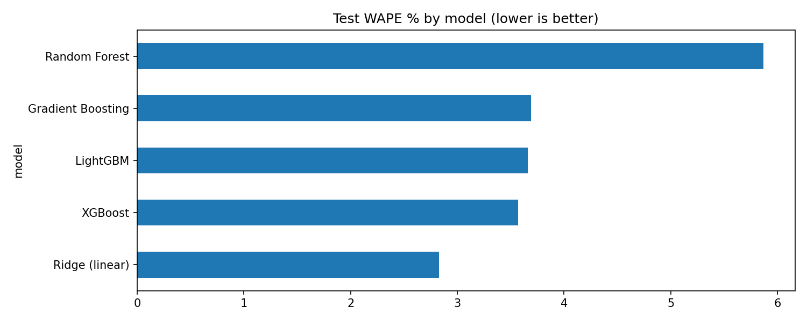
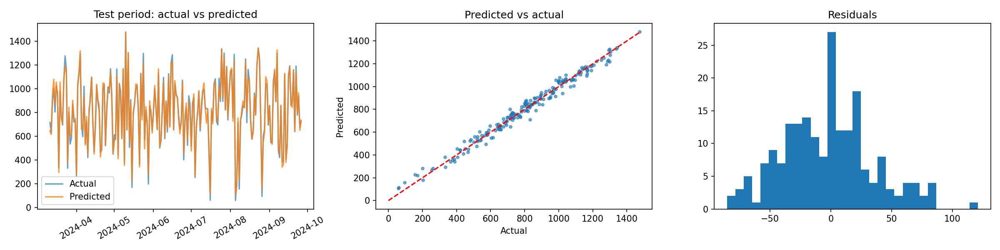
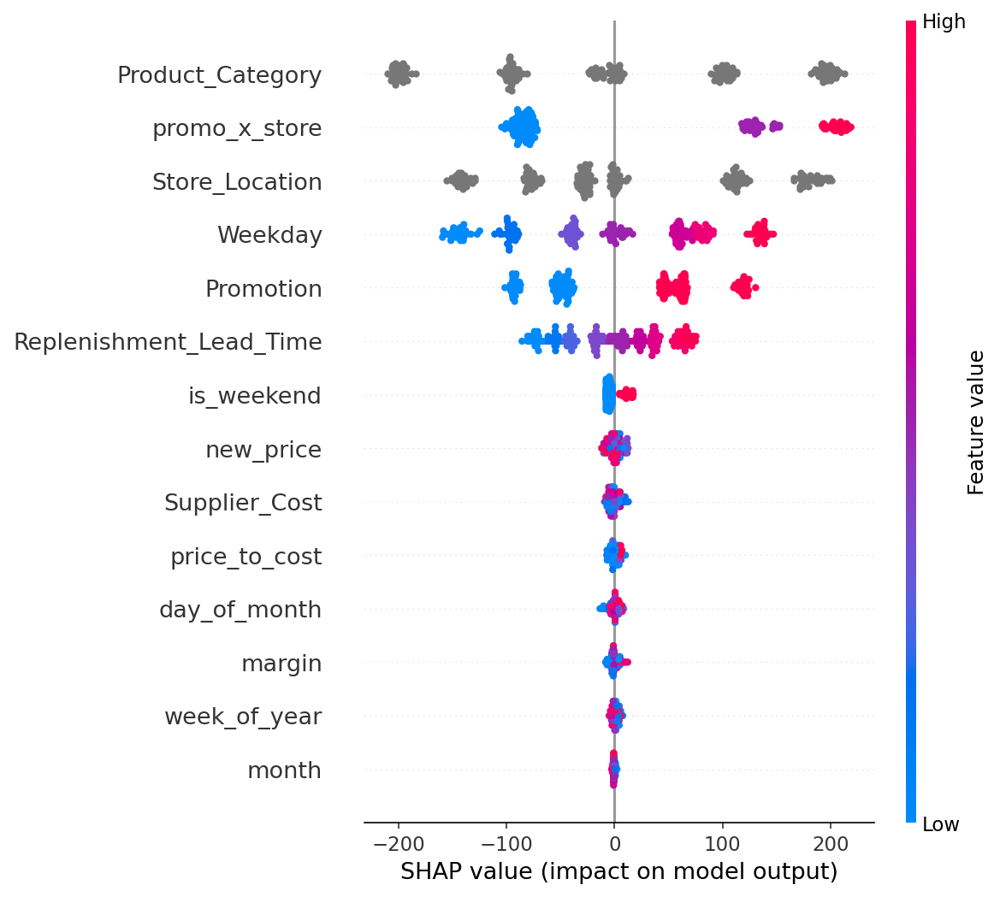
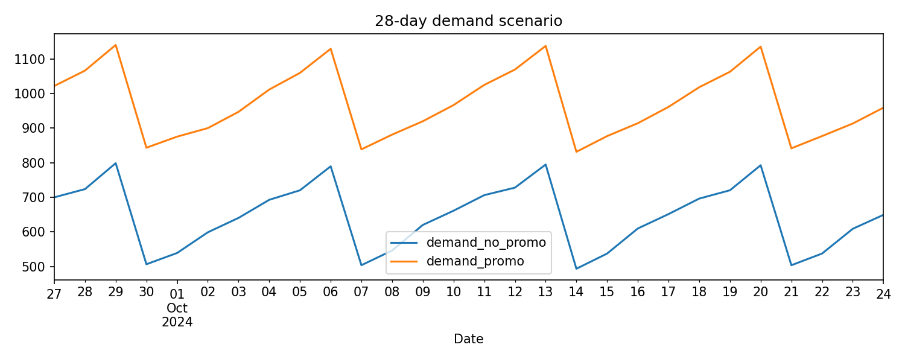

# 📦 FMCG Demand Forecasting

Built for the **Triwizathon Hackathon** · Team of 4 · **ML lead: Dheeraj Parihar**

A machine learning pipeline that checks whether FMCG (fast-moving consumer goods) sales data is actually forecastable, then compares five models with leak-free time-series validation and explains the winner with SHAP.

---

## 🎯 Problem

Retail planners need to know how much of a product will sell so they can plan stock, pricing and promotions. This project forecasts daily sales volume from planned inputs such as promotion, store, category, price and supplier lead time.

## 📂 Datasets

Both datasets come from Kaggle (1,000 daily rows each, 1 Jan 2022 to 26 Sep 2024).

| Dataset | File | Link |
|---|---|---|
| A (raw) | `extended_fmcg_demand_forecasting.csv` | [Kaggle link]https://www.kaggle.com/datasets/krishanukalita/fmcg-sales-demand-forecasting-and-optimization?resource=download|
| B (encoded) | `kaggle new datatset.csv` | [Kaggle link|https://www.kaggle.com/datasets/krishanukalita/fmcg-sales-demand-forecasting-and-optimization?resource=download |

The CSV files are not included in this repo. Download them from the links above.

## 🧭 Approach

1. **Audit** both datasets: missing values, duplicate dates, weekday consistency.
2. **Signal test**: check correlations and whether any model beats a "predict the mean" baseline.
3. **Feature engineering**: calendar features, margin, price-to-cost ratio, promotion × store.
4. **Time-ordered split**: oldest 80% for training, newest 20% for testing, with no shuffling.
5. **Model comparison** with `TimeSeriesSplit` cross-validation: Ridge, Random Forest, Gradient Boosting, XGBoost, LightGBM.
6. **Tuning**: randomized search on LightGBM.
7. **Explainability**: SHAP summary plot.
8. **What-if forecast**: 28-day demand with and without promotion.

## 🔍 Key finding 1: Dataset A is not forecastable

Every feature has near-zero correlation with sales, and no model beats the mean baseline (R² ≤ 0). It behaves like random noise, so it was excluded from modelling instead of forcing a result.

| Model (Dataset A) | MAE | WAPE | R² |
|---|---|---|---|
| Mean baseline | 475.4 | 45.1% | 0.000 |
| Ridge | 477.2 | 45.3% | -0.011 |
| Random Forest | 500.7 | 47.5% | -0.114 |
| LightGBM | 553.6 | 52.5% | -0.411 |

## 📊 Key finding 2: on Dataset B, a simple model wins

Results on the held-out latest 20% of Dataset B:

| Model | MAE | WAPE | R² | CV MAE |
|---|---|---|---|---|
| **Ridge (linear)** | **23.1** | **2.83%** | **0.989** | 25.8 |
| XGBoost | 29.1 | 3.57% | 0.982 | 41.9 |
| LightGBM | 29.8 | 3.66% | 0.982 | 58.0 |
| Gradient Boosting | 30.0 | 3.69% | 0.981 | 37.0 |
| Random Forest | 47.8 | 5.87% | 0.950 | 71.5 |
| *Mean baseline* | *227.1* | *27.9%* | *about 0* | n/a |

The tuned LightGBM scored MAE 29.4, WAPE 3.61%, R² 0.982. Ridge still won, because demand in this dataset is mostly additive in its inputs, so a more complex model adds nothing.

## 🧠 Explainability

SHAP shows which inputs drive predicted demand (store, category and promotion matter most).

## 🔮 What-if forecasting

The notebook builds a 28-day table of planned inputs and compares demand with promotion every day against no promotion.

> ⚠️ The uplift shown is a **scenario estimate from the model**, not a real-world measurement.

## ⚠️ Limitations (honest notes)

- Dataset B's sales values appear largely formula-driven. It shares dates, supplier costs, lead times and promotions with Dataset A but has different sales. The very high R² reflects how easily a simple model recovers that structure, and it should not be read as accuracy on real retail data.
- The data has one row per day, so there are no per-store or per-SKU time series and no lag features.
- No holidays or external events are included.

## 🚀 Next steps

- Use real per-SKU, per-store daily sales (2+ years).
- Add lag and rolling features (7, 14 and 28 days) and holiday effects.
- Try a global LightGBM model, Prophet or a Temporal Fusion Transformer.
- Add prediction intervals with LightGBM quantile regression.
- Monitor WAPE weekly and retrain monthly.

## 🛠 Tech stack

Python · pandas · NumPy · scikit-learn · LightGBM · XGBoost · SHAP · Matplotlib · Google Colab

## ▶️ How to run

1. Open `fmcg_demand_forecasting_triwizathon.ipynb` in [Google Colab](https://colab.research.google.com/) (File > Upload notebook, or the GitHub tab).
2. Download both CSV files from the Kaggle links above.
3. Run all cells (Runtime > Run all) and upload both CSVs when asked.
4. The notebook saves the trained models and a `figures` folder with all charts.

## 📁 Repository contents

| File | Description |
|---|---|
| `fmcg_demand_forecasting_triwizathon.ipynb` | Full notebook with outputs |
| `01_sales_trend.png` to `05_promo_scenario.png` | Charts from the notebook |

## 👥 Team

Team of 4 at **Triwizathon**. I (**[Your Name]**) built the machine learning pipeline: data audit, feature engineering, model comparison, tuning and explainability.

- Teammates: Tejashri Patil, Alfiya Mullah,Samruddhi Patil

## 📬 Contact

**Dheeraj Parihar** · www.linkedin.com/in/dheerajparihar · parihardheraj.p@gmail.com
